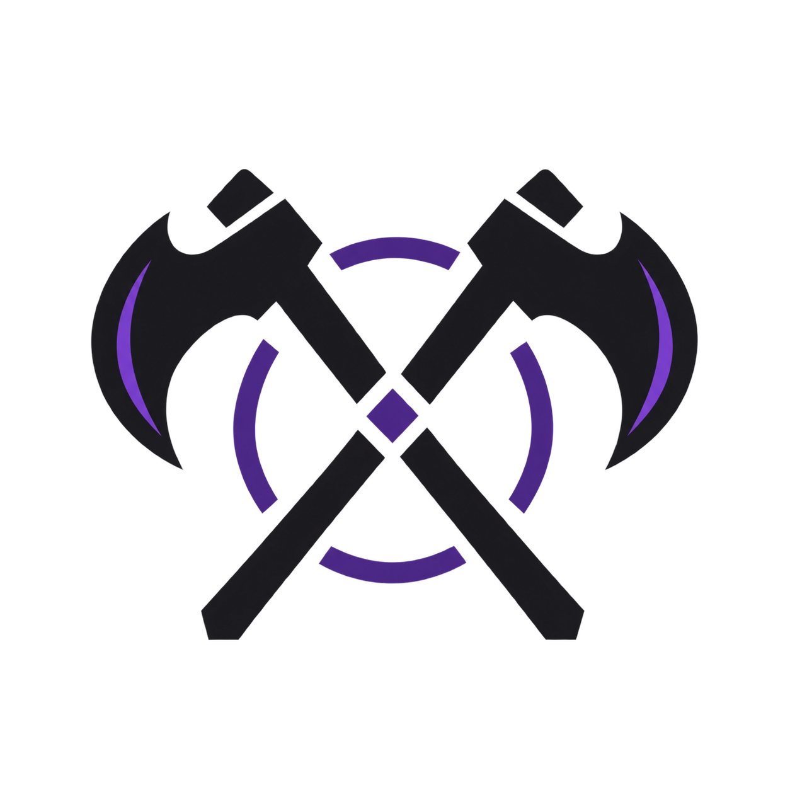

<p align="center">
  
</p>

<h1 align="center">agent-rack-silka</h1>

<p align="center"><strong>Claude manda, Codex / OpenCode / Cursor trabajan.</strong></p>

Claude Code delega tareas de código a otros agentes CLI con **un solo tool call MCP** y recibe
solo la respuesta final (pocas líneas), sin el transcript. Es como un "CLI-anything" para
agentes: Claude dice qué hacer, cuál es el alcance, qué entregar y cómo probarlo, y sigue con lo suyo.

Se construye sobre [agent-rack](https://github.com/lakpriya1s/agent-rack) (MIT) y agrega:

- **Soporte real para Windows.** agent-rack no se instala ahí por defecto y rechaza prompts multilínea con CLIs `.cmd`.
- **Cursor** como sub-agente, porque agent-rack no lo trae.
- **OpenCode** con salida JSON limpia en vez de texto de terminal, y que sobrevive a sus auto-actualizaciones.
- **Setup de un comando**: detecta tus agentes, genera la config, registra el MCP en Claude Code e instala el skill `delegar`.

```
Claude ──codex_run / agent_session_create──▶ agent-rack (MCP) ──▶ shims/agent-shim.mjs ──▶ codex | opencode | cursor-agent
   ▲                                                                                               │
   └───────────────────────────── respuesta final (JSON corto) ◀───────────────────────────────────┘
```

## Instalación

Requisitos: **Node.js 20+**, [Claude Code](https://claude.com/claude-code) y al menos uno de:

| Agente | Instalar | Login |
|---|---|---|
| Codex | `npm i -g @openai/codex` | `codex login` |
| OpenCode | `npm i -g opencode-ai` | `opencode auth login` |
| Cursor | [cursor.com/cli](https://cursor.com/cli) | `cursor-agent login` |

```bash
git clone https://github.com/Abraham2106/agent-rack-silka.git
cd agent-rack-silka
npm run setup
```

Luego **reinicia Claude Code** y prueba con:

```bash
npm run smoke
```

`smoke` le pide a cada agente que cree un archivo en `sandbox/` y muestra el tiempo, la respuesta y el resultado.

### Opciones del setup

```bash
npm run setup -- --workspace ~/code --workspace ~/work   # dónde pueden trabajar los agentes (defecto: carpeta padre del repo)
npm run setup -- --codex-model gpt-5.1-codex             # modelo de Codex (defecto: el de ~/.codex/config.toml)
npm run setup -- --opencode-model openrouter/qwen/qwen3-coder
npm run setup -- --policy read-only                      # read-only | workspace-write (defecto) | danger-full-access
npm run setup -- --scope project                         # user (defecto) | project | local
npm run setup -- --no-register --no-skill
```

El setup es idempotente: vuelve a correrlo cuando instales otro agente o quieras cambiar algo.
Conserva las carpetas y modelos que no pases por flag.

## Uso desde Claude

Solo pídelo, por ejemplo: *"delega a Codex agregar paginación a /users, con tests"*. El skill
`delegar` le enseña a Claude cuándo delegar y cómo escribir un prompt corto. Las herramientas son:

| Herramienta | Qué hace |
|---|---|
| `codex_run` · `opencode_run` · `cursor_run` | Corre la tarea y espera a que termine. Parámetros: `prompt`, `workspace`, `timeoutSeconds`, `model`. |
| `agent_session_create` | Lanza en segundo plano y devuelve un `sessionId` al instante (hasta 5 en paralelo). |
| `agent_session_status` · `agent_session_logs` | Estado, y las últimas líneas del log (`tail`) solo si algo falla. |
| `agent_session_send` | Seguimiento en la misma conversación, por ejemplo "corre los tests y confirma". |
| `agent_review` | Revisión de solo lectura que devuelve `verdict` y `findings`, para que un agente revise a otro. |

Un buen prompt de delegación tiene cuatro cosas: **tarea, alcance, entrega y prueba**.

Para ver los agentes en vivo desde otra terminal: `npx agent-rack watch`.

## Cómo funciona

- [`shims/agent-shim.mjs`](shims/agent-shim.mjs) es el puente:
  - **Codex**: passthrough a `codex exec --json`, que agent-rack ya entiende. El shim resuelve el binario real y lo lanza sin shell.
  - **OpenCode**: `opencode run --format json`, traducido al formato JSON de Claude Code. Le indica el directorio de trabajo, porque OpenCode resuelve rutas relativas contra la raíz del repo git.
  - **Cursor**: `cursor-agent -p --output-format json --trust`. `mode=plan` se traduce a `--mode plan` (solo lectura) y la escritura a `--force`.
  - En Windows lee el `.cmd` de npm en el PATH para encontrar el `.exe` o `.js` real. Así el prompt llega intacto (saltos de línea, comillas, `&`, `%`) y sigue funcionando aunque el CLI se actualice y cambie de ruta.
  - La salida cruda de la última corrida queda en `shims/logs/last-<agente>.log` para depurar.
- `agent-rack.config.json` lo genera el setup con rutas absolutas locales (está en `.gitignore`). Hay un ejemplo en [`agent-rack.config.example.json`](agent-rack.config.example.json).
- `.npmrc` trae `ignore-scripts=true` porque el postinstall de agent-rack es solo para Unix. `node-pty` ya incluye binarios precompilados.

## Problemas comunes

| Síntoma | Solución |
|---|---|
| `The 'X' model is not supported when using Codex with a ChatGPT account` | `npm run setup -- --codex-model <modelo válido>` (por ejemplo `gpt-6.1-sol`). |
| OpenCode: `API key has expired` o `requires more credits` | `opencode auth login`, o usa otro modelo con `--opencode-model`. |
| OpenCode: `OpenCode X or newer is required to use the free tier` | `npm i -g opencode-ai@latest` |
| Cursor: `Authentication required` | `cursor-agent login` |
| La tarea se queda colgada (modelo con rate limit) | Baja `timeoutSeconds` o cambia de modelo. Revisa `shims/logs/`. |
| `workspace ... not allowed` | Agrega la carpeta con `npm run setup -- --workspace <dir>`. |

## Seguridad

- Por defecto la política es `workspace-write`. Codex la aplica con su sandbox. Cursor y OpenCode no tienen sandbox de archivos, así que ahí se aplica por instrucciones.
- Los agentes solo pueden trabajar dentro de `allowedWorkspaces`.
- agent-rack quita del entorno las variables que parecen secretos antes de lanzar cada agente. Cada CLI usa su propio login.

## Licencia

MIT. Incluye [agent-rack](https://github.com/lakpriya1s/agent-rack) como dependencia (MIT).
El diseño original de la idea está en [`docs/PLANTEAMIENTO.md`](docs/PLANTEAMIENTO.md).
