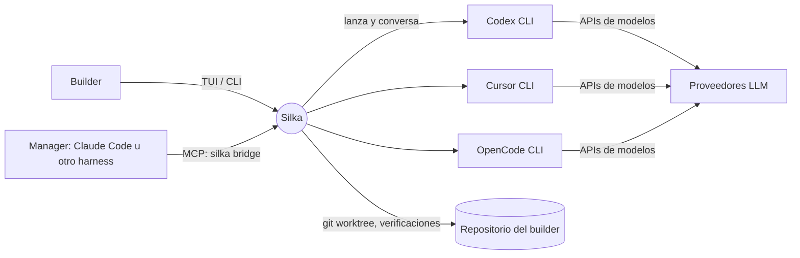
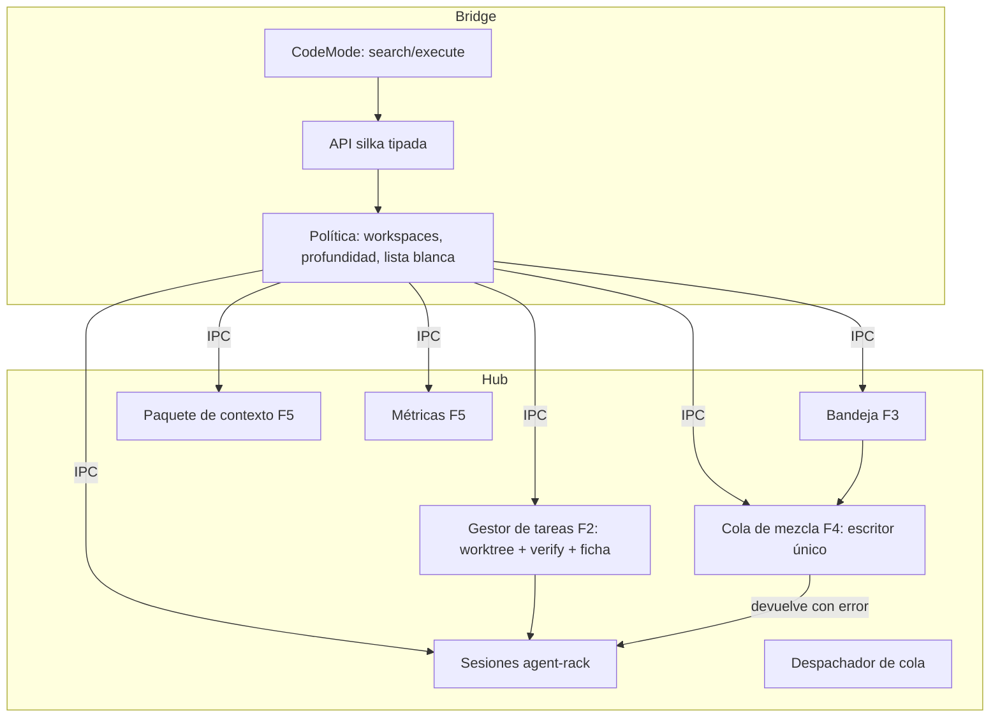

# Visión de arquitectura

## 1. Contexto (C4 nivel 1)

Actores: el **builder** (humano), el **manager** (un harness que delega) y los **agentes** (CLIs que ejecutan). Silka no llama a modelos por sí mismo: orquesta procesos de agentes y opera sobre el repositorio.

## 2. Contenedores (C4 nivel 2)

| Contenedor | Proceso | Responsabilidad | Estado que posee |
|---|---|---|---|
| **Hub** (`silka hub`) | Node, uno por máquina y puerto | Sesiones (vía agent-rack), despachador de cola, cola de mezcla (F4) | Sesiones en memoria (agent-rack) |
| **Bridge** (`silka bridge`) | Node, uno por cliente MCP | Proxy MCP al hub; Code Mode (F1); permisos, guarda de profundidad | Ninguno persistente |
| **Sandbox de Code Mode** | Node con `--permission`, efímero | Ejecuta el programa del manager contra la API `silka` por IPC | Ninguno |
| **Shim** (`shims/agent-shim.mjs`) | Node, uno por turno de agente | Traduce cada CLI, captura eventos, estado, historial, interrupciones | Escribe `.silka/`, historiales |
| **TUI** (`silka ui`) | Node + Ink | Vista y control humano | Ninguno (lee) |
| **Almacén de archivos** | Disco | `~/.config/silka/*` (global) y `<workspace>/.silka/*` (por repo) | Cola, notas, orígenes, historiales, tareas, decisiones, métricas |

## 3. Componentes de v1 (C4 nivel 3, dentro de Hub y Bridge)

## 4. Flujos principales

**Encargar en lote (F1 + F2):**
1. El manager llama `silka_execute(code)`.
2. El bridge abre el sandbox, y el código llama `silka.launch(plan)`.
3. Por cada tarea se crea un worktree y una sesión. `waitAll` espera en el hub sin bloquear el sandbox.
4. Al terminar cada tarea se corre `verify` y se genera la ficha.
5. El código filtra y devuelve solo las fichas.

**Revisar y mezclar (F3 + F4):**
1. El builder abre la bandeja y aprueba o rechaza.
2. Lo aprobado entra a la cola de mezcla, que es un escritor único.
3. La cola hace rebase, re-verifica y mezcla. Si algo falla, devuelve la tarea a su sesión con el error.

## 5. Atributos de calidad priorizados

Detallados en [atam.md](atam.md).

1. **Eficiencia de tokens por diseño** (sin pérdida de calidad).
2. **Seguridad**: sandbox, fronteras de confianza, nada de ejecución fuera de lo permitido.
3. **Corrección bajo concurrencia**: ninguna entrega duplicada ni perdida, ninguna mezcla corrupta.
4. **Productividad del builder**: tiempo para encargar y revisar.
5. **Mantenibilidad**: núcleo pequeño, dependencias mínimas.
6. **Portabilidad**: Windows de primera clase, macOS y Linux.
